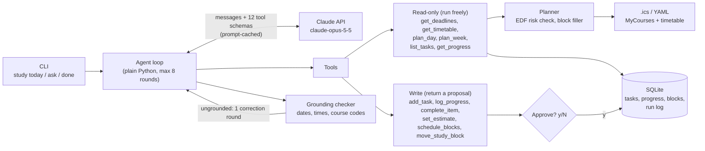

# Study Agent

**A personal AI agent that reads my Aalto course deadlines and timetable every morning, plans my day around my lectures, and warns me what is at risk. It uses Claude with tool calling, links every deadline to its source, and changes nothing without my approval.**

[](https://github.com/KALalev18/ai-agent-rework/actions/workflows/ci.yml)
 

```bash
uv run study demo      # try it now: fictional semester, no API key needed
uv run study today     # my real morning brief (needs an API key and my calendar URL)
```


<sub>The screenshot is a real `study demo` run, regenerated with `uv run python scripts/demo_screenshot.py`. Demo model turns are scripted; the tools, approval gate, checker and database are real.</sub>

---

## What it does

| Command | What happens |
|---|---|
| `study today` | Morning brief: today's lectures, suggested study blocks in free time, everything overdue / at risk / tight, deadlines in the next 7 days |
| `study week` | The next 7 days, one line per day, plus risks |
| `study ask "..."` | Any question: *"What's due this week?"*, *"Why is the project at risk?"*, *"Move my Saturday block to Sunday 13:00"* |
| `study done "..."` | *"finished exercise round 8, took 3 h"*: finds the deadline, proposes logging it, asks me y/n |
| `study add "..."` | *"email the TA by Wednesday, 15 min"* becomes a task, after approval |
| `study chat` | Multi-turn conversation |
| `study deadlines` | Deadline and risk table with **no model call**: the same deterministic data the agent sees |
| `study stats` | Days used, cost per day, latency p50/p95, grounding corrections, all from the run log |
| `study eval [--live]` | The 22-question evaluation set |

## Architecture



## Why I built it

At Aalto my deadlines are spread across MyCourses, course pages and my own notes, and I kept losing track of what was due when. A calendar shows *when* things are due, not whether I can still make it. This agent answers the question I actually have in the morning: *given my lectures and everything due, what should I work on today, and what am I about to miss?*

## How the agent loop works

[`agent.py`](src/study_agent/agent.py) is a plain `for` loop, about 100 lines, with no agent framework:

1. Send the question, the 12 tool schemas and the conversation to Claude.
2. If Claude answers with `tool_use` blocks, my code runs each tool and sends **all** results back in one message. Errors go back as `is_error` results, so the model can correct a bad argument (e.g. a block that overlaps a lecture).
3. Repeat until Claude gives a final answer, with a **hard limit of 8 model calls** per question, so a confused model cannot loop and spend money.
4. Run the grounding checker on the answer (below). If it finds an unsupported claim, send one correction message and loop once more.

**Why no framework?** The loop is the part I need to understand completely: where the approval gate sits, when to stop, what is retried. In a framework that logic is spread across callbacks. Here every step is visible, testable in replay mode, and easy to explain.

## Why tool calling instead of pasting the calendar into the prompt

- **The model doesn't do arithmetic on my calendar.** Risk and free time are computed by deterministic, tested Python ([`planner.py`](src/study_agent/planner.py)). The model chooses which tools to call and explains the result. Language models are good at language and bad at adding up hours across 14 days.
- **Smaller, fresher context.** A semester calendar is hundreds of events. Tools return only the requested range, already filtered (e.g. "opens" events and finished deadlines are dropped).
- **Checkable answers.** Every fact in an answer must exist in a tool result from this run, which is what makes the grounding checker possible.
- **Same data with or without the model.** `study deadlines` prints the exact data the agent sees, with no model call.

### How risk is computed

For each open deadline (sorted by due time), the planner compares the **work needed up to and including it** (my estimate minus logged minutes, plus everything due earlier) with the **free study time before it** (study window minus lectures, capped per day). This is the earliest-deadline-first (EDF) feasibility test: with one worker and deadlines, if work does not fit in EDF order, it does not fit in any order. Ratio above 1 is `at_risk`, above 0.75 is `tight`. Estimates start from keyword defaults (exam 10 h, project 15 h, exercise 4 h, quiz 1 h) and I correct them with `set_estimate`.

## Why a human approval step

Every write tool returns a **proposal** instead of writing. The loop shows it, asks `y/N` (default **No**), and only then calls `apply()`. Read tools run freely.

```
┌─────── Proposed change: Log progress ───────┐
│ Note: Finished exercise round 8              │
│ For: D-503d90 MS-C9002: Exercise round 8     │
│ Time spent: 180 min                          │
│ Also mark it as done                         │
└──────────────────────────────────────────────┘
  Apply this change? [y/n] (n):
```

The gate is enforced by **code structure**, not by asking the model nicely: write handlers have no path to the database except through the approved proposal. Without an interactive terminal (cron, CI) every change is declined. Tests check that a declined write leaves every table unchanged, for each of the 6 write tools. A declined change goes back to the model as "declined, do not retry".

## How grounding works and what the checker catches

The system prompt tells Claude to use only tool results. A prompt is not a guarantee, so [`grounding.py`](src/study_agent/grounding.py) checks the result:

1. Extract every **date** (`Fri 27 Nov`, `27.11.`, `2026-11-27`, `Nov 27`), **time** (`23:59`) and **course code** (`CS-E4780`) from the answer.
2. Collect the same facts from everything my side put in front of the model in this run: tool results, the question, and the current time.
3. Flag anything in the answer that is not in that set, and **weekday/date mismatches** (`Fri 28 Nov` when 28 Nov 2026 is a Saturday, a classic language-model error).
4. If anything is flagged, send the model one correction: *"your answer mentions X, which is in no tool result"*. If the rewrite is still ungrounded, the CLI shows a red warning instead of hiding it.

It is deterministic (no second model call), so it costs nothing and cannot itself hallucinate. Its limit: it checks facts, not reasoning. The `hallucination-trap` eval case scripts an invented exam date on purpose; the checker flags the date and the time, and the correction removes them.

## How I evaluate it

[`evals/cases.yaml`](src/study_agent/evals/cases.yaml) has **22 questions** against a fictional semester (made-up course codes, clock frozen at Mon 23 Nov 2026 08:00). Each case checks:

- **tool calls**: expected tools called, forbidden ones not (no write tools for a read question, no move when *"move my block to Friday"* is ambiguous);
- **facts**: expected facts present, forbidden ones absent (e.g. a finished assignment, a non-existent exam date);
- **grounding**: zero ungrounded claims after the checker;
- **database**: SQL assertions afterwards, e.g. a declined change leaves no trace and a moved block is at the right UTC time.

The cases include writes with approval and with refusal, a block move that the tool refuses because it would land after the deadline, an ambiguous request, a past-deadline check, and an out-of-scope question (*"What's the weather?"*).

Two modes, and I keep them separate on purpose:

| Mode | Command | What it proves |
|---|---|---|
| **Replay** (CI, every push) | `uv run study eval` | The harness: tools, approval gate, checker, scoring, database. Model turns come from recorded live runs if present, otherwise from hand-written scripts. Deterministic and free. |
| **Live** (on demand) | `uv run study eval --live --record` | The model: does Claude call the right tools and state only grounded facts? Costs money; `--record` saves the responses so CI can replay them. |

A replay score says the plumbing works; only the live score says the model works.

## Timezone handling

Everything is `Europe/Helsinki`, and every datetime in the code is timezone-aware.

- MyCourses exports due times in UTC (`21:59Z` is 23:59 in winter and `20:59Z` in summer). They are converted with `zoneinfo`, which applies the right offset for each date.
- Date-only deadlines mean 23:59 that day. Floating times are read as Helsinki time.
- Recurring lectures (`RRULE`) stay at 10:15 local time across the October DST change.
- SQLite stores **UTC** strings. Comparing `+03:00` and `+02:00` ISO strings as text sorts them wrongly across the change; a test stores blocks on both sides of 25 Oct and checks the query order.
- The current time goes into the **user message**, not the system prompt, so the system prompt stays byte-identical and cacheable.

Tests cover deadlines at 23:59 on both sides of the October and March changes.

## Privacy and secrets

- The MyCourses calendar URL contains a private token. It lives only in `.env` (gitignored), the settings object hides it from `repr`, download errors are re-raised without the URL (`from None`, so not even the traceback shows it), and tool results label the source `mycourses.ics`. Tests assert the token never appears in errors, warnings or tool results.
- **Only course codes, titles and times go to the model.** The parser never reads `DESCRIPTION`. No grades, no other people's data.
- If a download fails, the last cached calendar is used with a visible warning.
- A secret scanner ([`scripts/check_secrets.py`](scripts/check_secrets.py)) runs in pre-commit and in CI. It blocks API keys, calendar tokens and MyCourses export URLs. Pre-commit also refuses `.env` and database files.

## Cost control

- **Prompt caching** with two breakpoints: the tool schemas plus system prompt (identical on every run), and the growing conversation inside a run, so each tool round re-reads earlier rounds from cache at a fraction of the input price.
- **Hard limit** of 8 model calls per question (`STUDY_MAX_ROUNDS`).
- **Effort** defaults to `medium` (`STUDY_EFFORT`).
- Every run logs input, output, cache-read and cache-write tokens, the cost and the latency to SQLite; `study stats` summarises them.
- **Estimated** cost before real use: about €0.05 per `study today` on `claude-opus-5-5` (≈3k cached prompt tokens, ≈2k tokens of tool results, ≈1–1.5k output tokens), so roughly **€0.10–0.25 per day**. This is an estimate; the measured figure will come from `study stats`. Setting `STUDY_MODEL=claude-haiku-5-5` costs far less, at some quality risk that the live eval would show.

## Measured results

Every number here comes from a command in this table. Numbers I have not measured yet are marked as pending.

| What | Result | Command |
|---|---|---|
| Tests | **125 passed**, 89% branch coverage | `uv run pytest --cov` |
| Eval, replay mode | **22/22** cases; 0 ungrounded claims after the check; the checker caught the 2 planted claims in `hallucination-trap` | `uv run study eval` |
| Eval, live mode | *pending* | `uv run study eval --live --record` |
| `study today` latency p50 / p95 | *pending, needs daily use* | `uv run study stats` |
| Cost per day of real use | *pending* | `uv run study stats` |
| Days used | *pending* | `uv run study stats` |

## How I use it every day

*To be written from my own run log after a week of use: days used, average cost, and one deadline it caught.*

## Run it

**Demo (no key, about a minute):**

```bash
git clone https://github.com/KALalev18/ai-agent-rework.git && cd ai-agent-rework
uv sync
uv run study demo
uv run study eval
```

**On your own calendar:**

1. `cp .env.example .env`, then set `ANTHROPIC_API_KEY`.
2. In MyCourses, open *Calendar → Export calendar*, export all course events for *Recent and next 60 days*, click *Get calendar URL*, and paste it into `STUDY_DEADLINES_ICS`.
3. Set `STUDY_TIMETABLE` to your timetable `.ics` URL or file, or to a YAML file like [`docs/timetable.example.yaml`](docs/timetable.example.yaml).
4. `uv run study sync`, then `uv run study deadlines` (no model call; check the data first), then `uv run study today`.

On Windows machines where an Application Control policy blocks the generated `study.exe`, use `uv run python -m study_agent today`; it is the same entry point.

**Development:** `uv run pytest`, `uv run ruff check`, `uv run mypy`, `uv run pre-commit install`.

## Project layout

```
src/study_agent/
  agent.py        the loop, system prompt, correction round
  tools.py        12 tool schemas + handlers; write tools return proposals
  planner.py      EDF risk check, free-slot finder, block suggestions
  grounding.py    the grounding checker
  llm.py          live Claude client (caching, fallback, errors) and replay client
  sources/        .ics + YAML parsing, download cache
  store.py        SQLite: tasks, progress, blocks, run log
  evals/          22 cases + runner;  demo/  fictional semester
  cli.py, render.py, stats.py
tests/            125 tests: parsing, DST, planner, approval gate, checker, loop, live request shape
```

## What I'd do next

- **Telegram morning message**: run `study today` on a schedule and send the brief; approvals as inline buttons.
- **Read course pages**: many Aalto courses post deadlines on their own pages, not in MyCourses. A fetch tool with the same grounding rules would cover them.
- **Learn my estimates**: compare logged minutes with estimates per course and adjust the defaults automatically.
- **Multi-agent planning** only if it earns its cost: a separate reviewer model could check plans against the run log, but the deterministic checker covers the cheap part today.
- **For 1,000 users**: move from the CLI to a service with per-user OAuth to MyCourses instead of private URLs, encrypted storage, per-user rate and cost limits, and the live eval as a release gate.

## License

MIT
